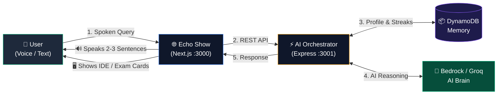
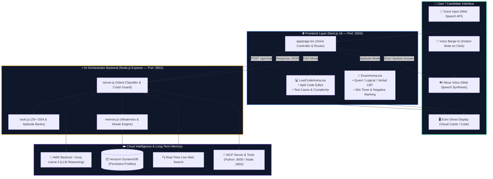

# 🚀 Alexa+ : AI Tech & Exam Prep Coach
**Primary Track:** Alexa+ (Build, Ship, Shape: Amazon Developer Hackathon 2026)  
**Live Submission:** [amazonappdev2026.devpost.com](https://amazonappdev2026.devpost.com/)

---

## 🌟 Executive Summary
Standard voice assistants are stateless command-receivers—great for alarms and weather, but ineffective for deep technical learning. When a developer asks traditional Alexa to explain code, it either recites curly braces aloud or forgets the user's past mistakes five seconds later.

**Alexa+ Tech Coach** elevates the conversational assistant into an **interactive, multimodal AI mentor** designed for the **Amazon Echo Show**. It simulates real FAANG-style whiteboard interviews:
1. **Listens to your spoken thought process** ("I'll use a two-pointer approach").
2. **Evaluates Big-O Time & Space Complexity in real-time**.
3. **Visually renders syntax-highlighted code on screen** while keeping voice answers crisp and concise.
4. **Tracks candidate weaknesses across sessions** using **Amazon DynamoDB**, tailoring subsequent daily challenges to past struggles.

---

## 💡 Key Innovations (Why This Wins Over Traditional Alexa)

| Capability | Traditional Alexa | Alexa+ Tech Coach |
| :--- | :--- | :--- |
| **Brain / Reasoning** | Rigid Slot-Intent rules | Generative AI Reasoning (AWS Bedrock / Groq) |
| **Code Presentation** | Speaks raw syntax aloud | **Multimodal Separation:** Speaks concepts, renders IDE code |
| **Personalization** | Stateless (forgets every session) | **Amazon DynamoDB Memory:** Tracks streaks, weak topics, and solved counts |
| **Interview Coaching** | Cannot evaluate verbal logic | **Verbal Complexity Analysis:** Evaluates $O(N)$ vs $O(N^2)$ and logs weaknesses |
| **Tool Extensibility** | Closed ASK Skills | **Model Context Protocol (MCP)** + Real-time Live Web Search |

---

## 🏗️ System Architecture & Workflow

### ⚡ 1. Short Architecture Diagram (Quick 5-Second Overview)
> **Summary:** User speaks or types ➔ AI orchestrator detects intent & fetches weakness profile ➔ Alexa speaks voice answer while Echo Show renders live code IDE or CBT exam cards.



---

### 🧩 2. Complete Project Architecture Diagram (Full System)



---

### 🔄 3. How It Works (Step-by-Step Execution Flow)

| Step | Action | Description |
| :---: | :--- | :--- |
| **1** | **Voice / Text Input** | Candidate bolta hai ya text type karta hai (*"Alexa, give me a DSA question"* ya *"Quantitative aptitude test"*). |
| **2** | **Voice Barge-In** | Agar Alexa bol rahi ho aur user mic touch kare, to Alexa ka bolna turant stop ho jata hai taaki user bina rukawat apna query bole. |
| **3** | **Intent & Weakness Match** | Backend DynamoDB se user ka **Streak** aur **Weak Topics** check karta hai, aur unhi topics ke basis par tailored question select karta hai. |
| **4** | **AI Reasoning** | AWS Bedrock / Groq LLM problem aur explanation process karta hai. |
| **5** | **Multimodal Separation** | **Voice:** Alexa sirf 2-3 concise sentences bolti hai.<br/>**Screen:** Echo Show screen par syntax-highlighted **LeetCode IDE** ya **CBT Exam Cards (A/B/C/D)** render hote hain. |
| **6** | **Real-time Feedback** | Candidate jab verbal approach bolta hai (*"I'll use a Hash Map in O(N)"*), Alexa verbal logic evaluate karke score update karti hai. |

---

### 🧠 Specialist AI Personas (Mode Routing)
- **💻 Tech Coach (DSA):** Java algorithms, whiteboard logic, verbal Time/Space complexity evaluation, and visual code highlighting.
- **📚 Study Coach (Quant & Aptitude):** Speed math, time/work formulas, and aptitude problem banks for Amazon Online Assessments.
- **🌐 General Assistant:** Grounded live web search, tech news, and real-time facts.

---

## 🚀 Running Locally

### 1. Prerequisites
- Node.js v18+ (Tested on v24)
- Web browser (Chrome / Edge recommended for Web Speech API)

### 2. Start Backend (Port 3001)
```bash
cd backend
npm install
node server.js
```
*(Runs with local persistent memory fallback and real-time search. Add your AWS credentials in `.env` to sync with Amazon DynamoDB & Bedrock).*

### 3. Start Echo Show Frontend (Port 3000)
```bash
cd frontend
npm install
npm run dev
```
Open **[http://localhost:3000](http://localhost:3000)** in your browser.

### 4. (Optional) Start Interactive MCP App (Port 3002)
```bash
cd mcp-app
npm start
```

---

## ☁️ 1-Click Cloud Deployment Guide

### A. Deploy Frontend to Vercel (Free)
1. Push your repository to GitHub.
2. Go to [Vercel](https://vercel.com) and import the repository.
3. Set **Root Directory** to `frontend`.
4. Add Environment Variable:
   - `NEXT_PUBLIC_BACKEND_URL`: Your deployed backend URL (e.g., `https://alexa-plus-backend.onrender.com` or leave empty for local).
5. Click **Deploy**. Vercel will build and provide a live HTTPS URL with browser microphone support.

### B. Deploy Backend to Render / Railway (Free)
1. In [Render](https://render.com), create a new **Web Service** connected to your repository.
2. Set **Root Directory** to `backend`.
3. Set **Build Command** to `npm install`.
4. Set **Start Command** to `node server.js`.
5. Add Environment Variables:
   - `GROQ_API_KEY`: Your Groq API key
   - `AWS_ACCESS_KEY_ID`: *(Optional)* AWS Access Key
   - `AWS_SECRET_ACCESS_KEY`: *(Optional)* AWS Secret Key
   - `AWS_REGION`: `us-east-1`
6. Health Check Path: `/health`.

---

## 🎙️ Try These Prompts in the Demo

1. **Daily Problem:**  
   *"Alexa, give me a daily problem"*  
   *(Alexa checks your DynamoDB weakness profile, selects a problem, and highlights Java code on screen).*

2. **Verbal Algorithm Evaluation:**  
   *"I will solve this using a two pointer approach"*  
   *(Alexa analyzes $O(N)$ time & $O(1)$ space, praises your reasoning, and logs it to your profile).*

3. **CBT Exam Simulator (Aptitude & Reasoning):**  
   *"Alexa, switch to Study Coach"* -> *"Give me a quantitative aptitude question"*  
   *(Interactive CBT Exam Arena renders with live timer, negative marking, hints, and derivations).*

4. **Real-Time Web Search:**  
   *"Who won the 2024 ICC Men's T20 World Cup?"* or *"Latest tech news today"*  
   *(Searches the live web and speaks the accurate, verified answer).*

---

## 🛡️ License
Open source under the [MIT License](LICENSE). Built for the **Amazon Developer Hackathon 2026**.

